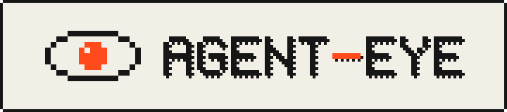
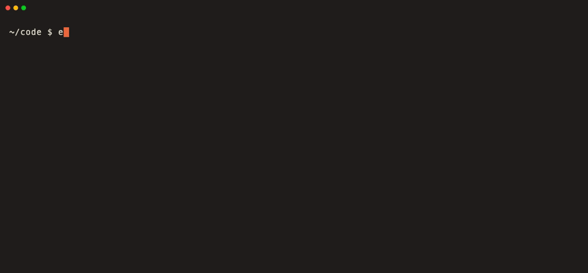
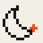
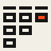
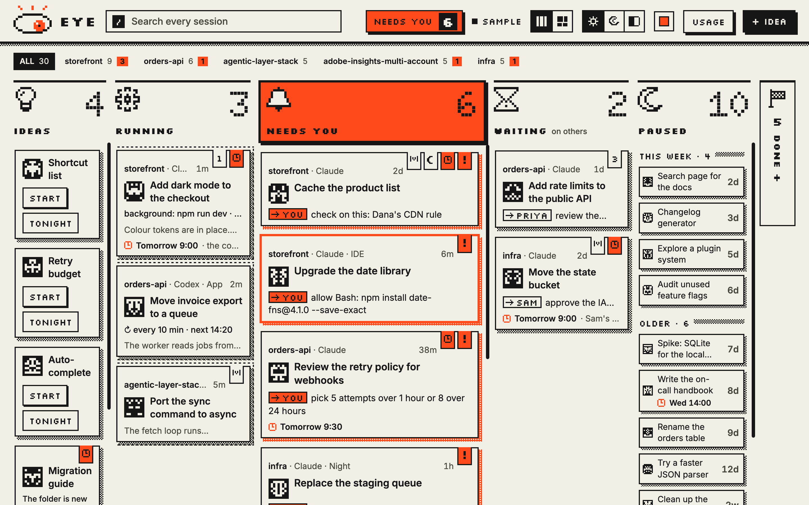

<p align="center">
  <picture>
    <source media="(prefers-color-scheme: dark)" srcset="assets/banner-dark.svg">
    
  </picture>
</p>

<p align="center">
  <b>Keeps an eye on your agent sessions, even overnight.</b><br>
  A local index, a terminal picker and an optional pixel-art board. macOS and Linux.
</p>

<p align="center">
  <a href="https://github.com/maxipavlovic/agent-eye/actions/workflows/ci.yml"></a>
  <a href="https://sonarcloud.io/summary/overall?id=maxipavlovic_agent-eye"></a>
  <a href="https://sonarcloud.io/summary/overall?id=maxipavlovic_agent-eye"></a>
  <a href="https://crates.io/crates/agent-eye"></a>
  <a href="https://github.com/maxipavlovic/agent-eye/releases/latest"></a>
  <a href="LICENSE"></a>
  
</p>

<p align="center">
  
</p>

## Why

Coding agents forget, and they leave things behind. Claude Code deletes transcripts after 30 days, you lose track of which session did what, nothing tells you which one is waiting on you, and finished work leaves servers running and commits on no remote. agent-eye keeps an index of every session on your machine, puts you back in one with one key, and shows what is left to finish.

## Features

<table>
<tr><td width="48"></td><td><b>Search that understands you:</b> word forms, typos, and the PR and ticket links in a session.</td></tr>
<tr><td></td><td><b>Resume from your prompt:</b> Ctrl-G, a few words, Enter. Ctrl-F forks.</td></tr>
<tr><td></td><td><b>Nothing lost:</b> a compressed copy of every transcript, and <code>eye export</code> to take it all to another machine.</td></tr>
<tr><td></td><td><b>Know what needs you:</b> each session's state, next step and owner.</td></tr>
<tr><td></td><td><b>Leftovers, cleaned up:</b> servers still running, commits on no remote. You stop, remove or copy, and eye asks first. <code>eye forget</code> removes a session for good.</td></tr>
<tr><td></td><td><b>Night shift:</b> planned work runs while you sleep, in its own worktree or copy, inside your plan, and never pushes. Off until you switch it on (<a href="docs/night.md">night</a>).</td></tr>
<tr><td></td><td><b>What it costs:</b> tokens and an API-equivalent estimate per session, project and agent, plus plan limits (<a href="docs/usage.md">usage</a>).</td></tr>
<tr><td></td><td><b>Works with</b> Claude Code, Codex, Antigravity and OpenCode, and alongside T3 Code and <code>claude agents</code>.</td></tr>
<tr><td></td><td><b>Local only:</b> no account, no telemetry.</td></tr>
</table>

## Install

```sh
brew install maxipavlovic/tap/agent-eye   # or: cargo install agent-eye
agent-eye install                         # --dry-run shows what it changes
```

No Homebrew or Rust? Take the installer script from the [latest release](https://github.com/maxipavlovic/agent-eye/releases/latest). `agent-eye install` sets up the hooks, the background service and the `eye` command. Upgrade the way you installed (`brew upgrade agent-eye`, `cargo install agent-eye`, or the script again); the background service moves to the new version by itself. Run `agent-eye install` once after an upgrade to bring the `/eye` skills up to date.

Needs macOS 11+ or Linux (glibc 2.35+), and Claude Code, Codex CLI, Antigravity CLI (`agy`) or OpenCode. Codex runs eye's hooks after you approve them once with `/hooks`. Linux notes: [docs/linux.md](docs/linux.md).

## Use

```sh
eye                       # the picker: type to search, Enter resumes
eval "$(eye init zsh)"    # in ~/.zshrc: Ctrl-G opens the picker from your prompt
eye board on --open       # the board
eye usage                 # tokens, cost and plan limits
eye loose                 # leftovers: what sessions left running or unpushed
eye night                 # work planned for tonight
eye export                # one file with everything, to move or keep
eye forget <id>           # remove a session (--transcript: from its agent too)
```

<p align="center"><a href="assets/board-demo.gif"></a></p>

`eye import <file>` reads an export back on another machine, paths rewritten ([docs/backups.md](docs/backups.md)).

## Privacy

Everything stays on your machine. Summaries run your agent's own CLI on a short excerpt (secrets masked) and count against your plan; turn them off in `~/.agent-eye/config.toml`. `agent-eye uninstall` reverts every change. Details: [docs/security.md](docs/security.md).

Works with Claude Code, Codex CLI, Antigravity CLI (`agy`) and OpenCode. Unofficial: not affiliated with Anthropic, OpenAI, Google or OpenCode.

## Docs

[Site](https://maxipavlovic.github.io/agent-eye/) · [Terminal](docs/terminal.md) · [Board](docs/board.md) · [Config](docs/config.md) · [Usage](docs/usage.md) · [Night shift](docs/night.md) · [Backups](docs/backups.md) · [Agents](docs/agents.md) · [API](docs/api.md) · [Testing](docs/testing.md) · [Changelog](CHANGELOG.md)

## License

[MIT](LICENSE). The board's fonts are under the SIL Open Font License ([licenses/](licenses/)).
