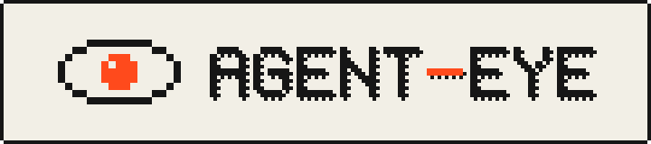
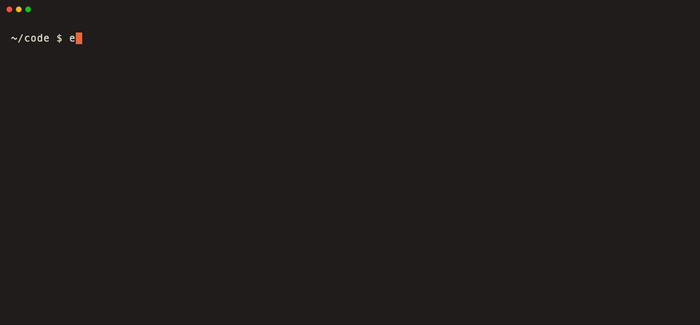
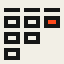
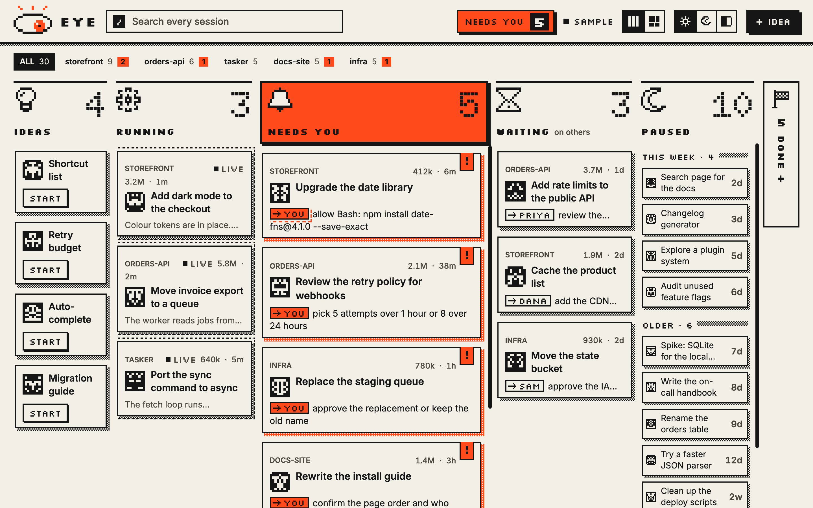

<p align="center">
  <picture>
    <source media="(prefers-color-scheme: dark)" srcset="assets/banner-dark.svg">
    
  </picture>
</p>

<p align="center">
  <b>Find, sort and resume your coding-agent sessions.</b><br>
  A local index, a terminal picker and an optional pixel-art board. macOS and Linux.
</p>

<p align="center">
  <a href="https://github.com/maxipavlovic/agent-eye/actions/workflows/ci.yml"></a>
  <a href="https://sonarcloud.io/summary/overall?id=maxipavlovic_agent-eye"></a>
  <a href="https://sonarcloud.io/summary/overall?id=maxipavlovic_agent-eye"></a>
  <a href="https://crates.io/crates/agent-eye"></a>
  <a href="https://github.com/maxipavlovic/agent-eye/releases/latest"></a>
  <a href="LICENSE"></a>
  
</p>

<p align="center">
  
</p>

## Why

Coding agents forget. Claude Code deletes transcripts after 30 days, you lose track of which session did what, and nothing tells you which one is waiting on you. agent-eye keeps an index of every session on your machine and puts you back in one with one key.

## Features

<table>
<tr><td width="48"></td><td><b>Search everything:</b> titles, prompts, replies, PR links, folders.</td></tr>
<tr><td></td><td><b>Resume from your prompt:</b> Ctrl-G, a few words, Enter. Ctrl-F forks.</td></tr>
<tr><td></td><td><b>Nothing lost:</b> a compressed copy of every transcript, restored on resume.</td></tr>
<tr><td></td><td><b>Know what needs you:</b> each session's state, next step and owner.</td></tr>
<tr><td></td><td><b>A board if you want one:</b> pixel-art, local, installable as an app, in one of eight accent colours.</td></tr>
<tr><td></td><td><b>Local only:</b> no account, no telemetry.</td></tr>
</table>

## Install

```sh
brew install maxipavlovic/tap/agent-eye   # or: cargo install agent-eye
agent-eye install                         # --dry-run shows what it changes
```

No Homebrew or Rust? Take the installer script from the [latest release](https://github.com/maxipavlovic/agent-eye/releases/latest). `agent-eye install` sets up the hooks, the background service and the `eye` command.

Needs macOS 11+ or Linux (glibc 2.35+), and Claude Code or Codex CLI. Codex runs eye's hooks after you approve them once with `/hooks`. Linux notes: [docs/linux.md](docs/linux.md).

## Use

```sh
eye                       # the picker: type to search, Enter resumes
eval "$(eye init zsh)"    # in ~/.zshrc: Ctrl-G opens the picker from your prompt
eye board on --open       # the board
```

<p align="center"><a href="assets/board-demo.gif"></a></p>

## Privacy

Everything stays on your machine. Summaries run your agent's own CLI on a short excerpt (secrets masked) and count against your plan; turn them off in `~/.agent-eye/config.toml`. `agent-eye uninstall` reverts every change. Details: [docs/security.md](docs/security.md).

Works with Claude Code and Codex CLI. Unofficial: not affiliated with Anthropic or OpenAI.

## Docs

[Site](https://maxipavlovic.github.io/agent-eye/) · [Terminal](docs/terminal.md) · [Config](docs/config.md) · [Backups](docs/backups.md) · [Agents](docs/agents.md) · [API](docs/api.md) · [Changelog](CHANGELOG.md)

## License

[MIT](LICENSE). The board's fonts are under the SIL Open Font License ([licenses/](licenses/)).
